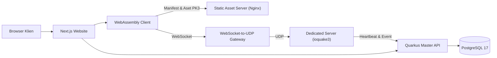

# Proyek Komputasi Awan (Cloud Computing) — Q3JS di Microsoft Azure

> **Tugas Praktikum / Proyek Komputasi Awan**  
> **Nama:** Nanda Pratama Sugiarto  
> **NIM:** 102062400019  
> **Kelas:** IS-07-01  

---

## 📌 Tentang Proyek

**Q3JS** adalah implementasi multiplayer *Quake III Arena* berbasis web modern yang dibangun di atas mesin **ioquake3** dan dikompilasi ke **WebAssembly (WASM)**. Proyek ini mencakup arsitektur terdistribusi lengkap yang siap di-deploy ke lingkungan cloud (seperti **Microsoft Azure**), yang terdiri dari:

1. **Website (Frontend)**: Antarmuka web berbasis Next.js, React, dan Tailwind CSS untuk server browser, peluncur game, profil pemain, dan papan skor.
2. **Client (WASM)**: Engine game ioquake3 yang berjalan langsung di browser pengguna via WebAssembly & WebGL.
3. **Master Server (Backend API)**: Service Quarkus (Java 17) sebagai registry server, ingest event/statistik pertandingan, dan GeoIP lookup.
4. **Database**: PostgreSQL 17 untuk menyimpan histori statistik permainan dan profil pemain.
5. **Game Server & Gateway**: Dedicated server Quake III native yang terhubung ke browser melalui gateway WebSocket-to-UDP.
6. **Static Asset Server**: Server Nginx untuk mendistribusikan manifest dan file aset game (`.pk3`) secara aman dan ter-cache.

---

## 🏗️ Arsitektur Sistem



| Komponen | Direktori | Stack / Teknologi | Fungsi |
|---|---|---|---|
| **Website** | `website/` | Next.js, React, Tailwind CSS | UI portal game, server list, statistik, & launcher |
| **Game Client** | `game/client/` | TypeScript, Emscripten, WebAssembly | Runtime browser, virtual filesystem, input controls |
| **Dedicated Server** | `game/server/` | ioquake3 (C/C++), Node.js, TypeScript | Game server & konversi WebSocket-to-UDP |
| **Master API** | `master/` | Java 17, Quarkus, jOOQ, Flyway | Pendaftaran server game, leaderboard, analitik |
| **Database** | Docker Compose | PostgreSQL 17 | Penyimpanan data relasional dan statistik |
| **Static Server** | `static/` | Nginx, Shell script | Pengiriman paket `.pk3` dan validasi manifest |

---

## ⚙️ Port & Layanan

| Port | Protokol | Layanan | Keterangan |
|---|---|---|---|
| `3000` | HTTP | Website (Frontend) | Akses portal web utama di browser |
| `5432` | TCP | PostgreSQL Database | Database penyimpanan statistik |
| `8080` | HTTP | Master Server API | REST API Quarkus & Swagger UI (`/q/swagger-ui`) |
| `8081` | HTTP | Static Asset Server | Penyedia file `.pk3` aset game |
| `27960` | UDP | Quake III Dedicated Server | Engine server game internal |
| `27961` | HTTP / WebSocket | Gateway Game | Koneksi WebSocket dari browser pemain |

---

## 📋 Prasyarat Sistem (Prerequisites)

Sebelum menjalankan aplikasi, pastikan sistem/VM Anda telah terpasang:
- **Node.js** versi 24 dan **pnpm** (disarankan `pnpm@11.x`)
- **Java 17 JDK** (untuk backend Quarkus Master Server)
- **Docker** dan **Docker Compose** (untuk database PostgreSQL dan container static)
- **C/C++ Compiler (gcc/clang)**, `make`, dan `zip` (untuk build server native ioquake3)
- **Emscripten SDK (emsdk)** (hanya jika ingin melakukan *recompile* game client WebAssembly)
- **File Data Quake III Arena** berlisensi legal (`baseq3/pak0.pk3` s/d `pak8.pk3`)

---

## 🚀 Panduan Menjalankan Secara Lengkap (Langkah demi Langkah)

> ⚠️ **Catatan Penting Direktori**: Seluruh perintah di bawah ini **wajib dijalankan dari dalam direktori `q3js/`**.

### 1. Masuk ke Direktori Proyek dan Instal Dependensi
```bash
cd q3js
pnpm install --frozen-lockfile
```

---

### 2. Menyiapkan Konfigurasi Environment (`.env.local`)
Salin template environment untuk website:
```bash
cp website/.env.example website/.env.local
```

Buka file `website/.env.local` dan pastikan konfigurasi URL mengarah ke service yang sesuai (gunakan `localhost` untuk pengujian lokal, atau gunakan IP Publik VM Azure Anda jika di-deploy ke cloud):
```env
NEXT_PUBLIC_Q3JS_STATIC_URL=http://localhost:8081
NEXT_PUBLIC_Q3JS_MASTER_URL=http://localhost:8080
Q3JS_MASTER_URL=http://localhost:8080
```

---

### 3. Menjalankan Layanan (Gunakan Terminal Terpisah)

Buka terminal-terminal berikut dan jalankan perintah pada masing-masing terminal dari dalam folder `q3js/`:

#### **Terminal 1: Menjalankan Database PostgreSQL**
```bash
cd q3js
docker compose up -d database
```
*Tunggu beberapa detik hingga container PostgreSQL siap menerima koneksi.*

#### **Terminal 2: Menjalankan Master Server API**
```bash
cd q3js
make master-run
```
*Layanan Master API akan berjalan di `http://localhost:8080`. Dokumentasi Swagger dapat diakses di `http://localhost:8080/q/swagger-ui`.*

#### **Terminal 3: Menjalankan Game Server & WebSocket Gateway**
Tentukan path direktori data game Anda (berisi folder `baseq3/*.pk3`):
```bash
cd q3js
export Q3JS_DATA_DIR=/path/ke/folder/data-quake
Q3JS_BASEPATH="$Q3JS_DATA_DIR" make server-run
```
*Server game akan berjalan di UDP port 27960 dan membuka gateway WebSocket di port 27961.*

#### **Terminal 4: Menjalankan Static Asset Server (Nginx)**
Static server bertugas menyediakan aset game untuk diunduh oleh browser klien:
```bash
cd q3js
export Q3JS_DATA_DIR=/path/ke/folder/data-quake
docker build -f static/Dockerfile -t q3js-static .
docker run --rm -p 8081:8080 -v "$Q3JS_DATA_DIR:/data:ro" q3js-static
```

#### **Terminal 5: Menjalankan Website Frontend**
```bash
cd q3js
pnpm --dir website dev
```
*Buka browser dan akses [http://localhost:3000](http://localhost:3000). Server game lokal akan terdeteksi otomatis pada server list.*

---

## ☁️ Catatan Deployment ke Microsoft Azure

Untuk keperluan praktikum / tugas **Komputasi Awan (Azure)**:
1. **Azure Virtual Machine (IaaS)**:
   - Buat VM Ubuntu di Azure.
   - Konfigurasi **Network Security Group (NSG)** untuk membuka port:
     - `3000` (Website)
     - `8080` (Master API)
     - `8081` (Static Assets)
     - `27961` (WebSocket Game Gateway)
     - `27960/UDP` (Quake Dedicated Server)
   - Sesuaikan konfigurasi `website/.env.local` agar mengarah ke **IP Public** atau **DNS Azure VM** Anda.
2. **Containerization (Docker & AKS/ACA)**:
   - Setiap service (`website/Dockerfile`, `master/Dockerfile`, `game/server/Dockerfile`, `static/Dockerfile`) dapat di-push ke **Azure Container Registry (ACR)** dan diorkestrasi via Docker Compose atau **Azure Container Apps / AKS**.

---

## 📜 Lisensi & Atribusi

Proyek ini menggunakan beberapa lisensi:
- Engine `game/engine/` (berbasis ioquake3) berlisensi **GPL-2.0-only**.
- Komponen web client, backend master, gateway server, dan website bersumber dari repositori asli Q3JS.
- Data aset asli Quake III Arena (`.pk3`) adalah hak cipta id Software / ZeniMax Media dan tidak didistribusikan dalam repositori ini.
